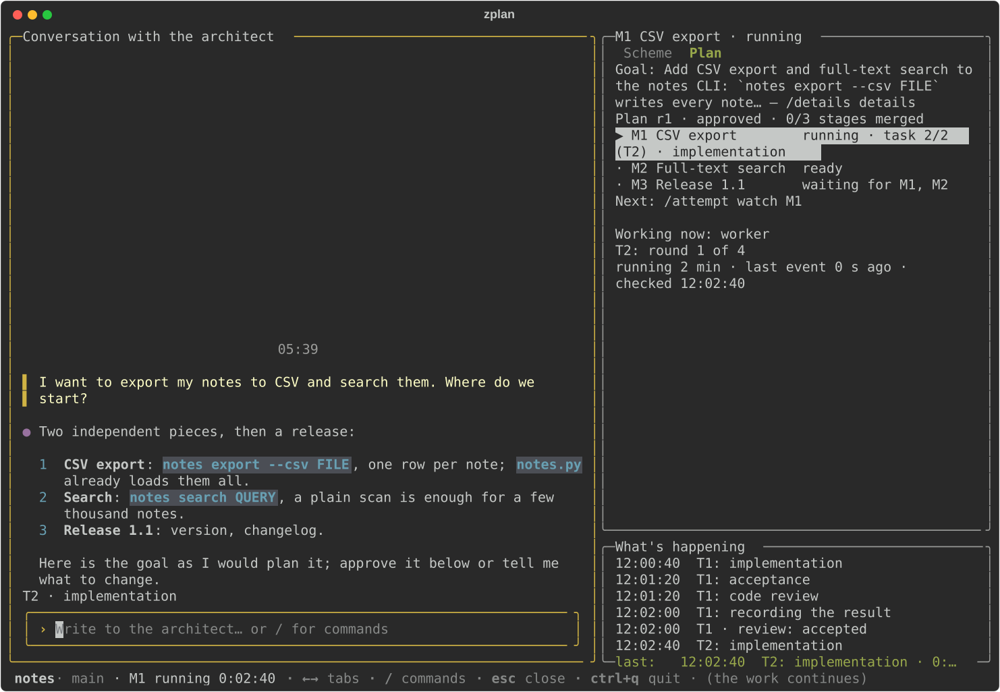
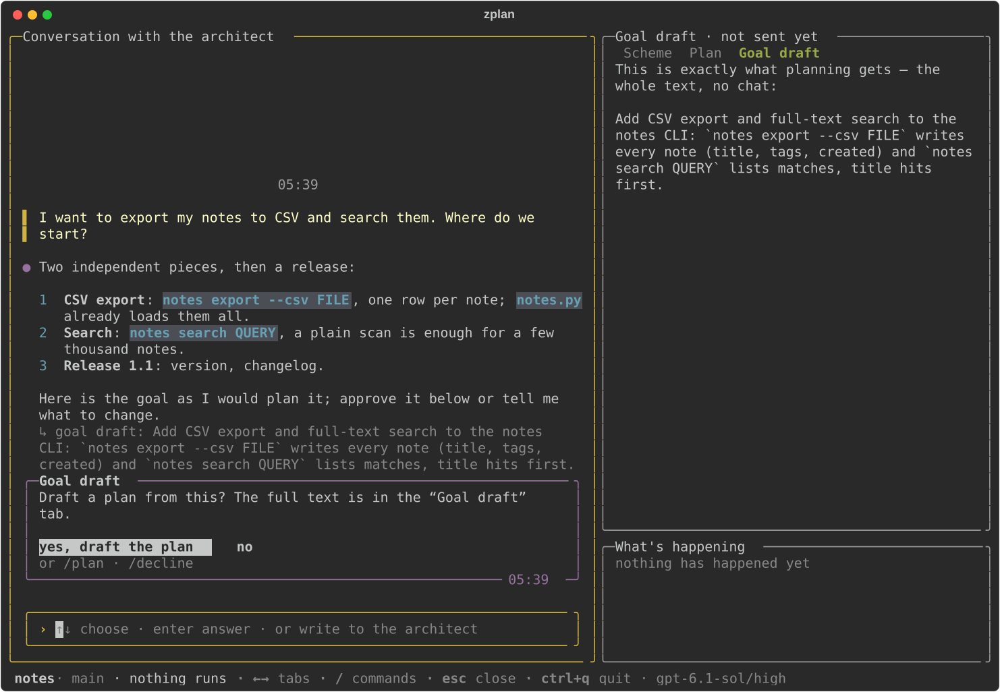
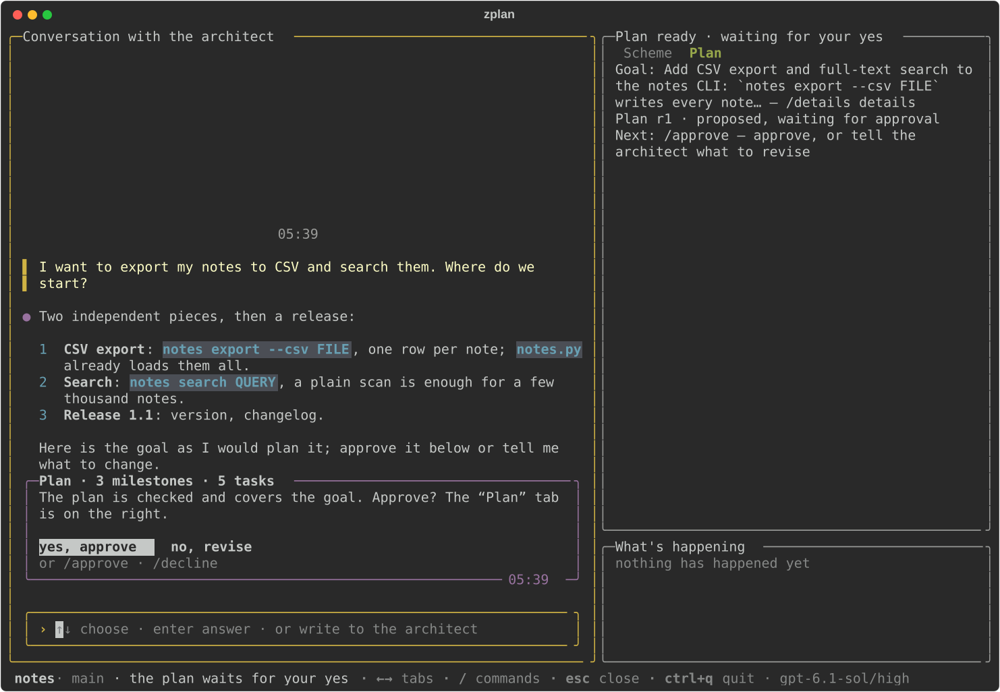
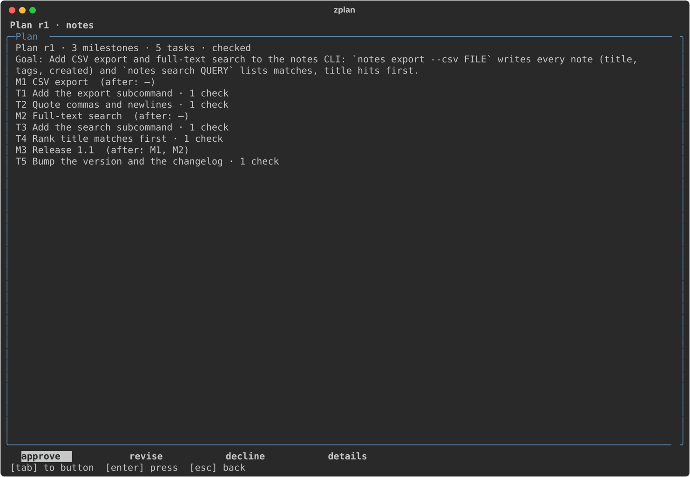
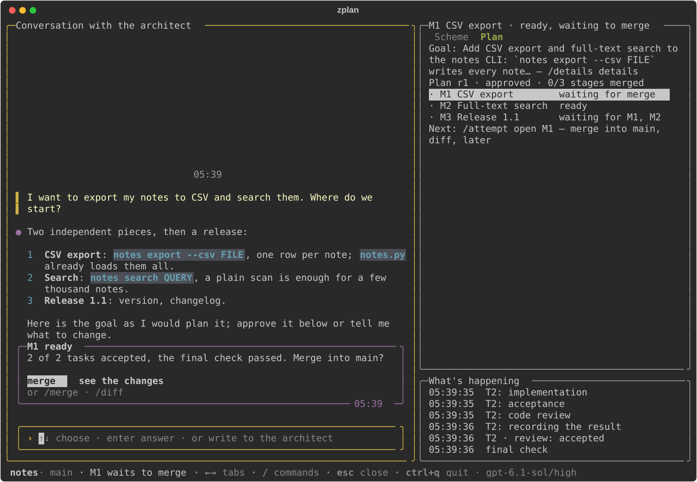

# zeroplan

**`zplan` turns a goal into a reviewed plan and delivers it milestone by milestone, with AI agents working in your
Git repository, at the autonomy level you choose.**



zeroplan 0.8.0 is a terminal client for the native [Zeroshot](https://github.com/the-open-engine/zeroshot) engine.
You describe what you want in a chat with an *architect*. A *planner* and an independent *critic* turn that into a
plan of milestones and tasks. Each milestone then runs as one Zeroshot run in its own Git worktree, where agents
implement the tasks, two reviewers check every task and a repair loop fixes what they reject. A finished milestone
becomes a branch you merge with one keypress. zplan never pushes.

- [How it works](#how-it-works)
- [Before you log in](#before-you-log-in) (cost, access, autonomy: read this first)
- [Install](#install)
- [A first session](#a-first-session)
- [Try it without a model](#try-it-without-a-model)
- [Everyday use](#everyday-use): commands, keys, subcommands
- [Configure a project](#configure-a-project): `zplan.process.json`
- [What zplan changes in your repository](#what-zplan-changes-in-your-repository)
- [Where state lives](#where-state-lives) · [Uninstall](#uninstall) · [FAQ](#faq) · [Development](#development)

## How it works

| Step | Who | What you see |
| --- | --- | --- |
| 1. Talk | You and the **architect** (Codex, read-only in your project) | A chat. The architect reads the code, answers and drafts the goal as a card |
| 2. Plan | The **planner** proposes requirements, milestones and tasks; the **critic** checks that the plan covers the goal | A plan card and the plan screen: approve, revise or decline |
| 3. Run | One native Zeroshot run per milestone, in a dedicated worktree: a **worker** per task, an **acceptance** and a **code reviewer** per task, a **steward** that keeps the task list healthy, a final check | Live progress: the current task, the round, every review verdict |
| 4. Merge | You | A "ready" card: merge, see the changes, or merge later. Milestones that depended on it become ready |

Independent milestones can run side by side (up to 3 by default). Close the terminal at any time: a run keeps going
in the background and `zplan` reattaches to it. Zeroshot owns the run lifecycle; zplan owns the roadmap, the plan
approval and the merge decision.

| | |
| --- | --- |
|  |  |
| **Talk.** The architect answers in the chat and drafts the goal; the "Goal draft" tab shows exactly the text the planner will get. | **Approve.** The planner's proposal, checked by the critic, arrives as a card: `yes, approve` or `no, revise`. |
|  |  |
| **Review.** `/view` opens the plan: milestones, their order and every task with its checks. | **Merge.** The card says what was accepted and what passed; `merge` lands it on your branch. |

## Before you log in

Read this before `zplan login`:

- **Account and model.** zplan runs Codex with your own login (`zplan login`, a device-code sign-in) and needs
  model access on that account: every role defaults to the model `gpt-6.1-sol` (`zplan roles` or the project's
  `zplan.process.json` changes it).
- **Cost.** Every planner revision, milestone run and architect turn spends model tokens on that account; zplan
  gives no estimate up front. A milestone run keeps running, and spending, after you quit zplan or close the
  terminal, until it finishes or you stop it.
- **Full access.** The planner and milestone agents run as your user through Codex with
  `sandbox_mode = "danger-full-access"` and `approval_policy = "never"`: without asking, they can read and change
  every file your user can, outside the project too (the whole HOME, including credentials such as SSH keys, tokens
  and cloud configs), and use the network. This is the default, and there is no guarded mode; run zplan only under
  a user and on a machine where that is acceptable. The architect chat itself runs Codex read-only.
- **Autonomy.** The process profile zplan proposes on the first start in a project sets `autonomy.level` to `auto`:
  while the full-screen shell is open, the architect approves a checked plan and starts or resumes ready
  milestones by itself. When zplan found a test command, the proposed profile also sets `gates.merge` to
  `required`, and at `auto` the architect then merges a milestone whose merge gate passed into your branch without
  asking you. `"autonomy": {"level": "manual"}` in `zplan.process.json` makes it ask for each of these;
  `supervised` asks for the plan approval and for every merge. On that first start, `configure` sets the autonomy level, parallel
  runs (1-3), the merge rule and each role's model and effort before saving; `/setup` → `profile` changes them later.
- **Stop a run.** In the full-screen shell type `/stop` and answer `yes`: it stops the milestone selected in the
  list, else the first running one (or the planner while it plans); repeat for each running milestone. In the line
  UI (`zplan --plain`) press `k` + Enter while watching the milestone, then `y`. Quitting zplan or closing the
  terminal only detaches.
- **Platforms.** macOS on Apple silicon (arm64) and Linux x86_64 / aarch64. Windows and Intel macOS are not
  supported: `zplan setup` stops on them.
- **Uninstall.** Stop running milestones, then delete the launcher `~/.local/bin/zplan`,
  `~/.local/share/planning-kit` (apps, tools, worktrees and zplan's Codex home `codex-home/` with its login),
  `~/.config/planning-kit`, the native Zeroshot state `~/.zp` and the plan store (`PlanningKit` under
  `~/Library/Application Support` on macOS, `~/.local/state` on Linux); the commands are in
  [docs/INSTALLATION.md](docs/INSTALLATION.md#uninstall).
- **Bugs.** Report them in the [GitHub issues](https://github.com/pinkynail228/zeroplan/issues) of this repository.

## Install

You need:

- macOS on Apple silicon, or Linux x86_64 / aarch64;
- Python 3.11 or newer with `venv` (`install.py` re-runs itself with `python3.13`, `python3.12` or `python3.11`
  from PATH when started by an older `python3`);
- Git 2.38 or newer, with an identity (`git config --global user.name` and `user.email`): milestone commits and
  your merges use it;
- Node.js 16 or newer with npm: `zplan setup` installs the pinned Codex with `npm ci`;
- `curl` for the one-command install.

On a fresh Ubuntu 24.04: `sudo apt-get update && sudo apt-get install -y python3 python3-venv git curl nodejs npm`
([docs/INSTALLATION.md](docs/INSTALLATION.md) has the details).

One command fetches the newest release, installs it into a private venv and runs `zplan setup`, which downloads
checksum-verified Zeroshot 10.16.0 and Codex 0.162.1 into zplan's own data directory (no model call):

```sh
curl -fsSL https://raw.githubusercontent.com/pinkynail228/zeroplan/main/install.sh | sh
export PATH="$HOME/.local/bin:$PATH"
zplan --version                        # zplan 0.8.0
zplan login                            # Codex device login, in zplan's own Codex home
```

Without Node.js and npm the command stops with a non-zero status and names the missing prerequisite; the `zplan`
launcher is already installed then, so install Node.js and npm and run `zplan setup`. zplan uses only its own pinned Zeroshot and Codex, because its planner and milestone
graphs are qualified against exactly these versions; a global `zeroshot` or `codex` is neither used nor changed.

From a checkout instead (the same installer):

```sh
git clone https://github.com/pinkynail228/zeroplan.git
cd zeroplan
python3 install.py                     # private venv + the `zplan` launcher
export PATH="${ZEROSHOT_TOOLS:-$HOME/.local}/bin:$PATH"
zplan setup                            # pinned Zeroshot + Codex (rerunnable, hash-checked)
zplan login
```

`zplan update` later moves to the newest release and keeps the previous app and a copy of the store for rollback
([docs/UPGRADE.md](docs/UPGRADE.md)). Paths, offline installs and upgrades: [docs/INSTALLATION.md](docs/INSTALLATION.md).

`zplan doctor` checks everything and changes nothing in your repository or in your `~/.codex`; its version check
of the pinned Codex may create zplan's own Codex home and Codex's temporary files there. On a machine where nothing is installed yet it starts
like this:

```text
Planning Kit 0.8.0 · Darwin arm64
Toolchain: zeroshot 10.16.0 · codex-cli 0.162.1 · restic 0.19.1 · directory ~/.local/share/planning-kit/tools/zeroshot-10.16.0-codex-0.162.1-runtime2
OK: native socket path 92 bytes
BLOCKED: zeroshot is not installed or damaged (...); run zplan setup.
BLOCKED: no login for provider openai in ~/.local/share/planning-kit/codex-home; zplan needs its own Codex login once — run zplan login or press [l]. ...
OK: git /usr/bin/git
OK: roles planner=gpt-6.1-sol/high; plan_verifier=gpt-6.1-sol/high; worker=gpt-6.1-sol/medium; reviewer=gpt-6.1-sol/high; steward=gpt-6.1-sol/high
OK: Target: Git project ~/src/notes
OK: Target: branch main
OK: Target: origin github.com/you/notes
```

## A first session

Run `zplan` inside a Git project: a repository with at least one commit, on a branch, with a GitHub `origin`
(Zeroshot names the project after it; zplan itself never pushes). Started elsewhere, zplan asks for the project's path.

```sh
cd ~/src/notes
zplan                                  # full-screen shell; zplan --plain for the line UI
```

1. **Accept the process profile.** On the first start in a project zplan shows the profile it proposes (models
   per role, review gates, autonomy) with `accept`, `configure` and `later`. `accept` writes `zplan.process.json`
   and commits it as `zplan profile`, touching nothing else; `later` writes nothing and uses the same values.
2. **Talk to the architect.** Type into `Write to the architect… or / for commands`, for example
   *"I want to export my notes to CSV and search them. Where do we start?"*. The architect reads the project and
   answers; when it proposes a goal, a **Goal draft** card appears with `yes, draft the plan` and `no`. You can
   also skip the chat: `/plan Add CSV export and full-text search to the notes CLI`.
3. **Approve the plan.** The planner works for a few minutes (progress on the "Scheme" tab), the critic checks the
   result, and a plan card asks *"The plan is checked and covers the goal. Approve?"*: `yes, approve` (`/approve`)
   or `no, revise` (`/decline`). `/view` opens the whole plan; its `details` shows every requirement and check.
   At autonomy `auto` (the proposed default) the card says the architect approves it itself and offers only
   `revise`; `/approve` still approves at once.
4. **Run a milestone.** `/run` starts the next ready milestone (at autonomy `auto` it starts by itself). The right
   pane shows the task, the round and each review verdict as they happen. `Ctrl+Q` quits and leaves the run
   running; `/attempt` watches it again later.
5. **Merge.** When a milestone is done, a card *"M1 ready · 2 of 2 tasks accepted, the final check passed. Merge
   into main?"* offers `merge` (`/merge`; pressing it is the confirmation) and `see the changes` (`/diff`). The
   milestones that depended on it become ready: `/run` again.

The same flow in the line UI, from a real demo session (`zplan --fixture demo --plain`, trimmed):

```text
zplan · demo (main, clean)
Goal: Add CSV export to the notes CLI
Plan r1 · approved · 0/2 stages merged
  · M1 First usable increment    ready
  · M2 Independent verification  waiting for M1
Next: [g] start M1
[g] start  [p] plan  [r] reconsider  [s] settings  [i] details  [q] quit
Choice: g
Start M1 · First usable increment (attempt 1)
  Work branch:     zplan-work/c8316c86/m1-2d214c/a1
  Result branch:   zplan/m1-2d214c-r1-c8316c86-a1
  Merge into:      main (from HEAD c99c54f)
  Roles:           worker gpt-6.1-sol/medium · reviewer gpt-6.1-sol/high · steward gpt-6.1-sol/high
Start M1? [y/N]: y
Watching M1 · First usable increment — Ctrl-C: detach (the run continues) · k + Enter: stop
  T1 · implementation
  T1 · review
  T1 · review: accepted
  final check
M1 · First usable increment — done, waiting for merge
  Tasks: 1/1 done
     ZPLAN_FIXTURE.md | 1 +
[m] merge into main  [d] diff  [l] later
Choice: m
Merge the result of M1 into main? [y/N]: y
Merged: M1 → main.
```

## Try it without a model

```sh
mkdir zplan-demo && cd zplan-demo && git init -q && git commit -q --allow-empty -m init
zplan --fixture demo                   # or: zplan --fixture demo --plain
```

The demo runs the same screens against a deterministic fixture: its own plan store, no Zeroshot, no Codex, no
tokens. Its plan is generic ("First usable increment", "Independent verification") whatever goal you type. The
architect chat is not available in it, so nothing approves or starts by itself: use `/approve` and `/run` (or the
cards). The merge is real: `merge` adds the fixture's commit (a `ZPLAN_FIXTURE.md` file) to your current branch,
which is why the commands above use a throwaway repository. Without an origin the full-screen shell first offers
**Add origin**; choose **Skip** for the demo.

## Everyday use

### The full-screen shell

On a terminal `zplan` opens the full-screen shell: the architect chat on the left with its input at the bottom, the
plan on the right under the `Scheme` and `Plan` tabs over the `What's happening` pane, and a bottom bar with
`project · branch · state` and the keys that work. It needs no mouse; below 100 columns it shows one pane at a time.

| Key | Does |
| --- | --- |
| `/` | opens the palette of the commands the current state allows |
| `Enter` | sends the typed line or presses the focused button |
| `Tab` | moves focus between the input and the plan pane |
| `←` / `→` | switch the tabs of the plan pane |
| `↑` / `↓` | on the plan pane, select a milestone; on a card, choose a button |
| `PgUp` / `PgDn` | scroll the chat |
| `Esc` | closes the palette, cancels the running architect turn (never a milestone) or goes back one level |
| `Ctrl+Q` | quits from anywhere; running milestones keep running |

Every action is a `/` command; the buttons on the cards run the same commands.

| Command | Does |
| --- | --- |
| `/plan GOAL` | plan a goal |
| `/approve`, `/decline` | approve the plan or a decision on a card; decline the card |
| `/view` | open the plan screen |
| `/run` | start the next milestone |
| `/attempt` | open the selected milestone's attempt (a running one is watched again) |
| `/answer` | open the answer draft of the selected milestone |
| `/merge`, `/diff` | merge the finished milestone into your branch; show its changes |
| `/open FILE` | show a project file on the right (view only) |
| `/log`, `/details`, `/status` | the run log tail; outcome, plan and diagnostics; what the work and the engine are doing |
| `/retry` | try the failed step again |
| `/stop` | stop the current work (asks first) |
| `/new` | a fresh architect session (the plan carries over) |
| `/setup` | Settings: readiness checks, install, `log in`, `check`, `roles`, `profile` |
| `/help`, `/quit` | the keys and commands; quit (the work continues) |

### The line UI

`zplan --plain`, `TERM=dumb`, piped input or output, and every subcommand use the line UI: single-letter keys, no
escape codes, no architect chat. When something is missing it starts with a readiness screen:

```text
zplan · notes · main
! The zplan tools are not installed
  Verified Zeroshot 10.16.0 and Codex 0.162.1 are required (zplan's own copy; global ones are left alone).
! Codex: no login in ~/.local/share/planning-kit/codex-home · provider openai — [l] log in (zplan's own login, not ~/.codex)
[u] install tools  [l] log in  [g] check again  [i] details  [q] quit
```

### Subcommands

| Command | Does |
| --- | --- |
| `zplan` | open the plan and milestones of the current Git project |
| `zplan status` | print the home screen once, without prompts |
| `zplan setup` | install the pinned Zeroshot and Codex into zplan's data directory |
| `zplan doctor` | check readiness: tools, login, Git, project, process profile |
| `zplan login`, `zplan logout` | log in to or out of Codex in zplan's own Codex home |
| `zplan update` | update zplan to the newest release |
| `zplan roles` | choose the model and effort for each role |
| `zplan profile`, `zplan profile init` | show the project's process profile; write `zplan.process.json` and commit it as `zplan profile` |
| `zplan help COMMAND` | help for one command, offline |

[docs/USER_FLOW.md](docs/USER_FLOW.md) describes every screen, command and key. [docs/REFERENCE.md](docs/REFERENCE.md)
lists every command, flag, key, state and error code.

## Configure a project

`zplan.process.json` at the project root is the project's process profile, tracked in Git so a team shares it.
This is the file `zplan profile init` writes:

```json
{
  "preset": "zplan.default/2",
  "rules": [],
  "roles": {
    "planner": {"model": "gpt-6.1-sol", "effort": "high"},
    "critic": {"model": "gpt-6.1-sol", "effort": "high"},
    "worker": {"model": "gpt-6.1-sol", "effort": "medium"},
    "reviewer": {"model": "gpt-6.1-sol", "effort": "high"},
    "steward": {"model": "gpt-6.1-sol", "effort": "high"},
    "architect": {"model": "gpt-6.1-sol", "effort": "high"}
  },
  "gates": {"plan": "required", "task": "off", "merge": "off"},
  "limits": {"plan_rounds": 3, "task_rounds": 2, "merge_rounds": 2},
  "autonomy": {
    "level": "auto", "max_runs": 3, "worker_round_minutes": 45, "run_minutes": 120,
    "structural_round": 3, "wakeups_per_hour": 12, "architect_retries": 3
  },
  "checks": []
}
```

| Key | Means |
| --- | --- |
| `roles` | model and effort (`low` … `max`) for each role |
| `rules` | up to 8 files of the repository (for example `AGENTS.md`) whose text reaches the planner and the critic |
| `gates.merge` | `required` runs `checks` on the exact merge commit before it lands |
| `checks` | commands without a shell, e.g. `{"name": "unit", "argv": ["npm", "test"], "timeout_s": 1800}` |
| `limits` | plan–critic rounds and repair rounds per task |
| `autonomy` | `manual`, `supervised` or `auto`; parallel runs; time limits |

All keys are optional; `zplan profile` prints the resolved profile with the source of every value. A
`zplan.architect.md` at the project root replaces the architect's shipped method
(`terminal_planner/resources/architect_method.md`). The full key reference is in
[docs/REFERENCE.md](docs/REFERENCE.md#process-profile).

## What zplan changes in your repository

- A working branch `zplan-work/...` per attempt and a result branch `zplan/...` per finished attempt. The agents
  work in worktrees under zplan's data directory, never in your checkout.
- Your merge commits: zplan builds the merge commit with `git merge-tree` and `commit-tree` under your Git identity
  and fast-forwards your branch to it. A conflict leaves your tree untouched; uncommitted changes do not block a
  merge unless the merge would overwrite them.
- One commit `zplan profile` with `zplan.process.json`, when you accept the profile or run `zplan profile init`.
- Local ignore lines in `.git/info/exclude` (never a tracked file): `/.zplan/` and the tool caches `__pycache__/`,
  `node_modules/`, `.pytest_cache/`, `.mypy_cache/`, `.ruff_cache/`.
- `origin`, only when you choose **Add origin** or **Replace origin** on the start screen of a project without a
  GitHub origin (the suggested `OWNER/REPO` is editable; **Skip** leaves it alone).

zplan never pushes, never stashes and never resets.

## Where state lives

| What | Where (defaults) |
| --- | --- |
| Application (one venv per version) | `~/.local/share/planning-kit/app/0.8.0` (`$XDG_DATA_HOME`) |
| `zplan` launcher | `~/.local/bin/zplan` (`$ZEROSHOT_TOOLS/bin` when set) |
| Pinned tools | `~/.local/share/planning-kit/tools/zeroshot-10.16.0-codex-0.162.1-runtime2/` |
| Codex home (login, config) | zplan's own `~/.local/share/planning-kit/codex-home`; an explicit `$CODEX_HOME` overrides it |
| Role defaults | `~/.config/planning-kit/roles.json` (`$XDG_CONFIG_HOME`) |
| Plans, approvals, run records | macOS `~/Library/Application Support/PlanningKit/production/v3/<project>/`; Linux `~/.local/state/PlanningKit/production/v3/<project>/` |
| Milestone worktrees | `~/.local/share/planning-kit/worktrees/` |
| Native Zeroshot history | `~/.zp` |

zplan logs in to and runs Codex in its own home: `zplan login` signs in there, and zplan writes its own versioned
`config.toml` profile there. Your own `~/.codex` is used only when you ask for it: sign in there with `codex login`
and export `CODEX_HOME` before starting `zplan`. Never copy `auth.json` between Codex homes: the refresh token is
single-use, and a copy breaks the other login.

## Uninstall

Stop running milestones (`/stop`), then remove the launcher, the data and config directories, the Zeroshot state
and the plan store listed above. The exact commands are in [docs/INSTALLATION.md](docs/INSTALLATION.md#uninstall).
`zplan setup` installs Codex with `npm ci`, which also fills npm's shared download cache `~/.npm`; it belongs to
npm, so zplan leaves it alone.

## FAQ

**Does zplan push or open pull requests?** No. Results are local branches; you merge them, and pushing is up to you.

**Can I close the terminal while a milestone runs?** Yes. The run continues and keeps spending tokens until it
finishes or you `/stop` it; `zplan` reattaches.

**Which models does it use?** Every role defaults to `gpt-6.1-sol` through your Codex login. Change them per
project in `zplan.process.json` or globally with `zplan roles`.

**Can I use an API key instead of a login?** Yes, for providers configured with an `env_key` in Codex: the
readiness screen's `[i]` shows the `export VAR=...` line to run.

**Does the repository need a GitHub origin?** Yes, for planning and milestone runs: Zeroshot names the project
after its origin. zplan never pushes to it. The fixture demo works without one (choose **Skip** on the origin screen).

**My project has rules for agents.** List those files in `rules` of `zplan.process.json`; the planner and the critic
read them. Milestone agents read the repository as it is, including your `AGENTS.md`.

**I used 0.7.** 0.8.0 is English only: a stored Russian language setting falls back to English, and old history stays
as it was written. See [docs/UPGRADE.md](docs/UPGRADE.md).

## Development

```sh
PYTHONPATH=.:tests python3 -m unittest discover -s tests          # local unit suite
python3.13 devtools/fasttest.py                                   # the same suite, in parallel
devtools/linux-test.sh                                            # full suite on a Linux test host
python3 devtools/toolchain-candidate.py --help                    # qualify a candidate toolchain (docs/UPGRADE.md)
```

Tests use deterministic fixtures and a scripted loopback provider; no test calls a real model.
`ZPLAN_TEST_WHEELHOUSE` names an offline wheelhouse (setuptools 75.8.0, wheel 0.45.1 and textual 8.2.8 with its
dependencies) for the installed-app tests; without it those tests skip. The screenshots in this README come from
`devtools/ui-lab/readme_shots.py`, which drives the shipped app on the same fixtures. zplan itself is built with
Zeroshot runs; the current status is in [STATE.md](STATE.md).

Code map (`terminal_planner/`):

- cli.py: interactive UI, also line-oriented PTY. tui/: full-screen UI (app.py screens, controller.py actions).
- engine.py: native planner graph adapter + deterministic fixture.
- authority.py: locked `planning.json` in store v3 (proposals, revisions, approval, milestone runs). export.py: tree -> branch plumbing.
- milestone.py: manifest, amendments, driver graph. runs.py: milestone run records + native/fixture driver adapter.
- plan_tree.py: the pure plan task tree (milestone -> slice -> task) with each task's status from a milestone
  manifest; its plain text lines.
- snapshot.py: tree identity. setup.py: pinned tools, roles, login, doctor.
- process.py: the project's process profile (`zplan.process.json`: roles, gates, limits, rules, checks) and its acceptance state.
- architect.py: the architect turn. The shipped architect method is `terminal_planner/resources/architect_method.md`; a `zplan.architect.md` at the project root replaces it on the first turn of a conversation (copy the shipped text to start).
- tui/chat.py: the architect chat of the full-screen shell: one conversation per project, one turn per owner message.
- tui/flow.py: the status wrapping and clipping helpers: `wrap_status` (cell-width wrapping of the Now status lines) and `clip` (cut to cells with a visible `…`).
- tui/text.py: the pure text helpers of the shell: terminal-cell fitting and eliding, the escape scan that shows a value, the compact counters.
- tui/chat_view.py: the chat pane's layout: the header fields, the rows, the scroll window and its clamped offset, the state line.
- tui/modals.py: the modal screens: help, confirm, bootstrap, finishing, the note and text forms, the run end screen and its journal title.
- tui/screens.py: the goal form with its readiness block, the plan screen and Settings.
- tui/card_kinds.py: the decision cards' kinds: the shared card registries and the merge, question, plan, ready and failed card sources.
- tui/card_host.py: `CardHost`, the card methods of the main screen: showing, closing and routing the cards, and the merge, question and failure card data.

## License

[MIT](LICENSE)
