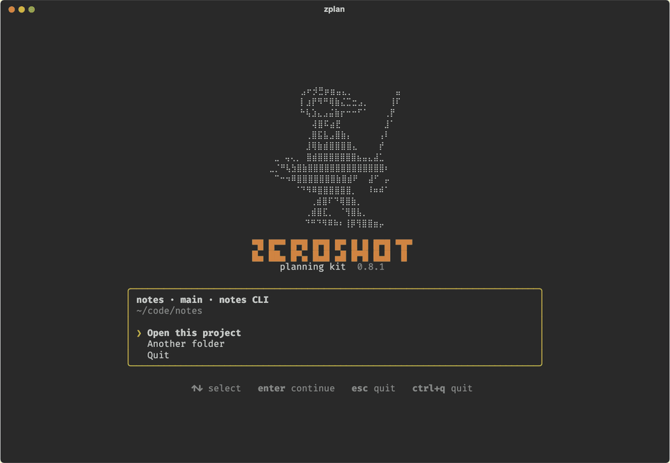
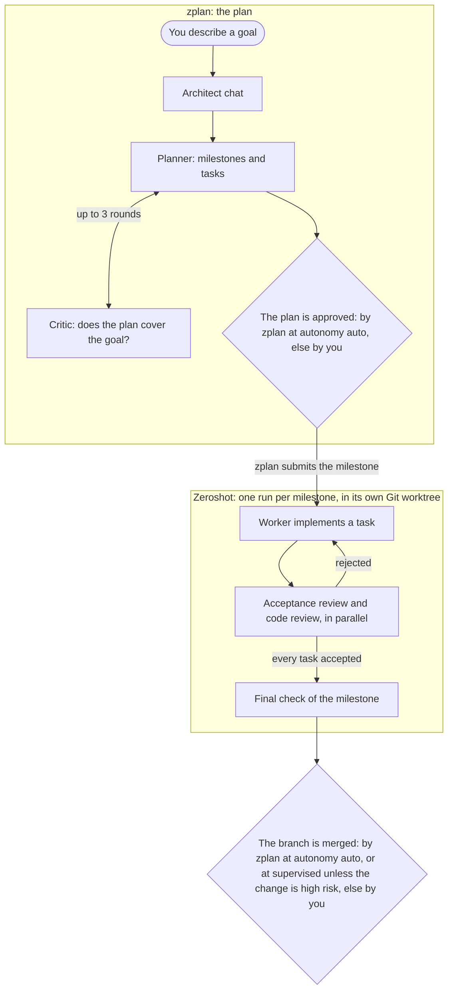
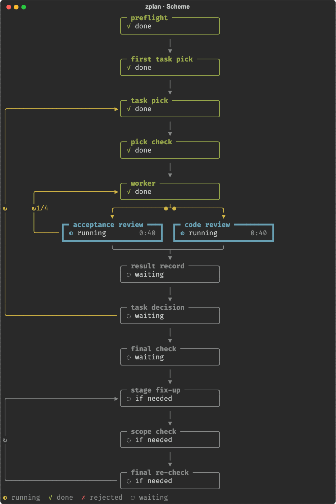

<h1 align="center">zeroplan</h1>

<p align="center">
  <b>Tell an AI architect what you want. Get a checked plan, then a reviewed Git branch for each milestone.</b><br>
  A terminal app for Codex, built on the <a href="https://github.com/the-open-engine/zeroshot">Zeroshot</a> engine.
</p>

<p align="center">
  <a href="https://github.com/pinkynail228/zeroplan/tags"></a>
  <a href="LICENSE"></a>
  
</p>

<p align="center">
  
</p>

<p align="center">
  <a href="#install">Install</a> · <a href="#try-it-free">Try it free</a> · <a href="#use-it-on-your-project">Use it</a> · <a href="docs/USER_FLOW.md">Guide</a>
</p>

Early release (0.9), macOS on Apple silicon only. Real runs use your Codex login and its tokens.

## Why zeroplan

- **You see the plan before any code changes.** A planner splits the goal into milestones and tasks, an independent
  critic checks that the plan covers it, and you approve it.
- **Every task is reviewed twice.** A worker writes it; an acceptance review and a code review must both pass, or
  the task goes back for another round.
- **Your checkout stays yours.** Each milestone runs in its own Git worktree and ends as a
  branch that zplan merges after its reviews pass, or that you merge, by autonomy level. zplan never pushes.
- **Runs outlive the terminal.** Up to 3 independent milestones run side by side; close the terminal and `zplan`
  reattaches.

## How it works

zplan is a layer over [Zeroshot](https://github.com/the-open-engine/zeroshot), not a replacement. Zeroshot runs the
work: its engine enforces a graph in which the agent that writes the code never approves it. zplan adds what comes
before and after a run (a conversation, a checked plan, the merge) and shows the run in your terminal.



Each milestone's graph follows Zeroshot's own
[worker, independent review, repair](https://github.com/the-open-engine/zeroshot#what-the-built-in-workflow-does)
pattern. Milestones that touch different files can run side by side, at most 3. `/scheme` draws the running graph
live on the whole screen, stage by stage:

<p align="center">
  
</p>

## Install

Needs Python 3.11+, Git 2.38+ with your `user.name` and `user.email` set, Node.js 16+ and curl
(`brew install python node`).

```sh
curl -fsSL https://raw.githubusercontent.com/pinkynail228/zeroplan/main/install.sh | sh
export PATH="$HOME/.local/bin:$PATH"   # add this line to ~/.zshrc too
```

zplan installs into its own folder with pinned, checksum-verified copies of Zeroshot and Codex; your global `codex`
and `~/.codex` are left alone.

**Installing through an AI agent?** It can run the two lines above. Run `zplan login` and `zplan` yourself, in your
own terminal: the login waits while you enter a code in the browser, and zplan is a full-screen app, so neither
works inside an agent's shell. An agent must not open another terminal for them.

## Try it free

A scripted demo: no login, no model, no tokens. Its merge is real, so use a scratch repository.

```sh
mkdir zplan-demo && cd zplan-demo && git init -q && git commit -q --allow-empty -m init
zplan --fixture demo
```

No login needed, whatever the installer suggests. Open the project, choose **Skip** on the origin screen and press
Enter to accept the profile. Then type `/plan Add a changelog`, `/approve`, `/run` (Enter starts it) and, when M1
asks "Merge into main?", `/merge`. The demo plan's M2 can wait. The architect chat is off in the demo, so its
`action.refused` line is expected.

## Use it on your project

> [!WARNING]
> - **It spends your Codex tokens**, with no estimate up front, and a run keeps going after you close the terminal.
> - **Agents have full access.** They run as your user without approval prompts and can read or change any file
>   your user can. Use a machine where that is acceptable.
> - **It acts on its own by default.** At autonomy `auto` zplan approves a checked plan, starts milestones and merges
>   each milestone once its reviews pass; without a test check it merges without one and says so. On the first
>   start choose `supervised` to approve plans and high-risk merges yourself, or `manual` to approve everything.
> - **`/stop` stops a run.** Quitting zplan only detaches.

```sh
zplan login                 # device-code sign-in, in zplan's own Codex home
zplan doctor                # fix any line marked BLOCKED
cd ~/src/my-project && zplan
```

The project needs a Git repository with a commit and a GitHub `origin` (Zeroshot names the project after it).
Describe the goal in the chat, approve the plan, watch the run, merge the branch. Type `/` for commands.

## Learn more

| | |
| --- | --- |
| [Installation](docs/INSTALLATION.md) | prerequisites, paths, offline install, uninstall |
| [User guide](docs/USER_FLOW.md) | every screen, card, command and key |
| [Reference](docs/REFERENCE.md) | commands, flags, profile keys, error codes |
| [Upgrade](docs/UPGRADE.md) | updates and rollback |
| [Architecture](docs/ARCHITECTURE.md) | code map, tests, how zplan is built |

Bugs and questions: [GitHub issues](https://github.com/pinkynail228/zeroplan/issues). License: [MIT](LICENSE).
